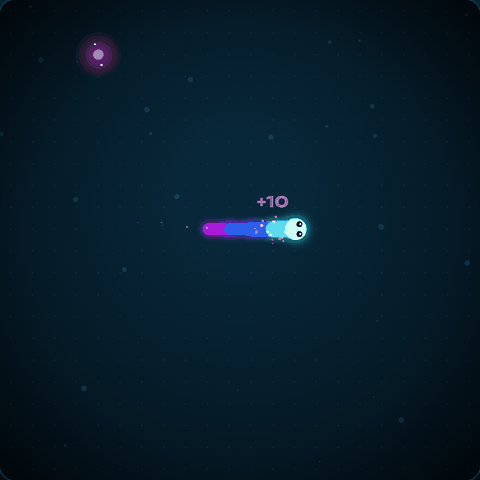
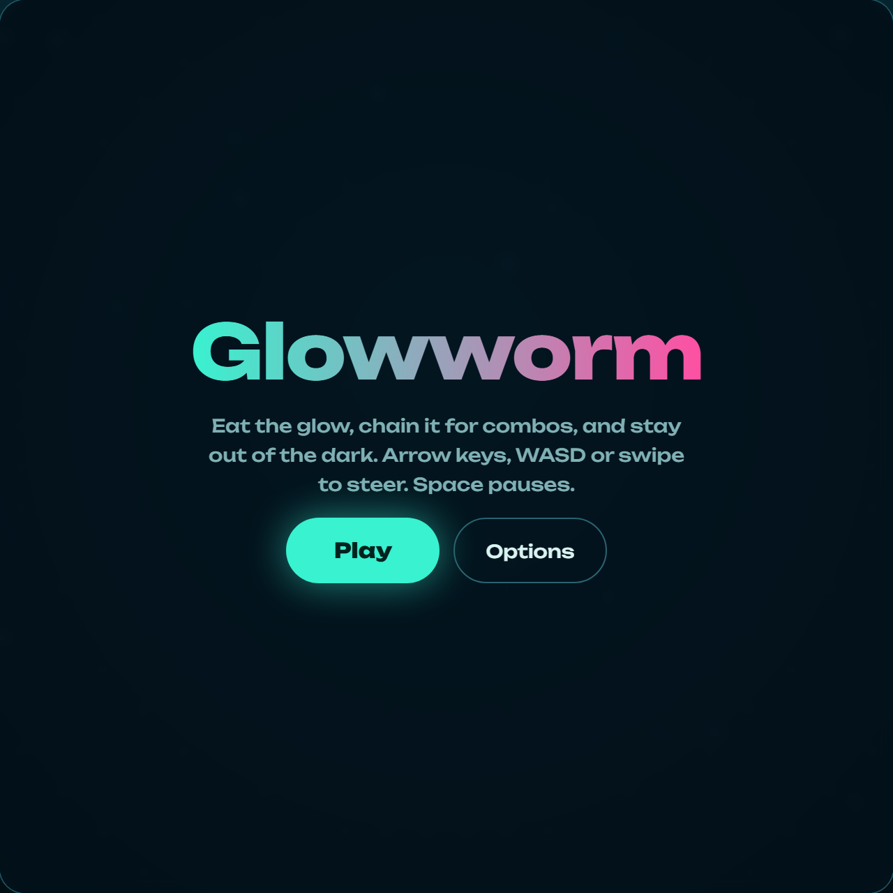
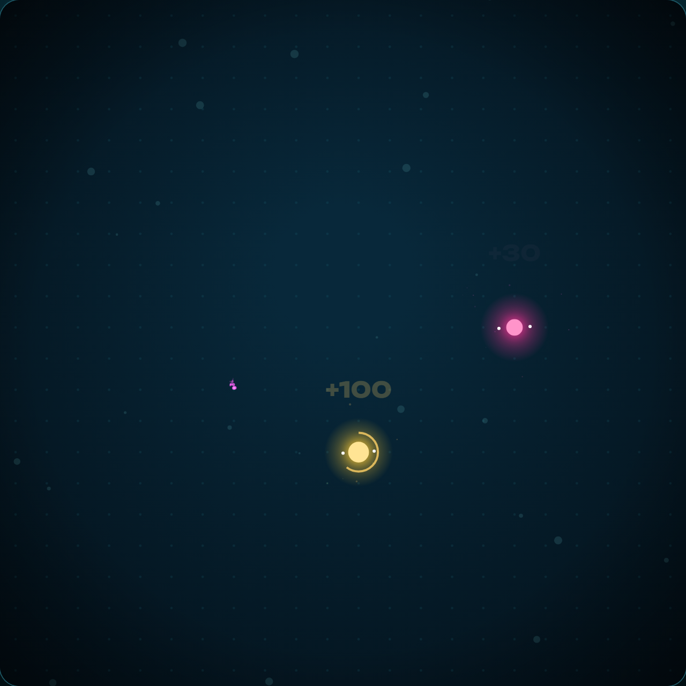
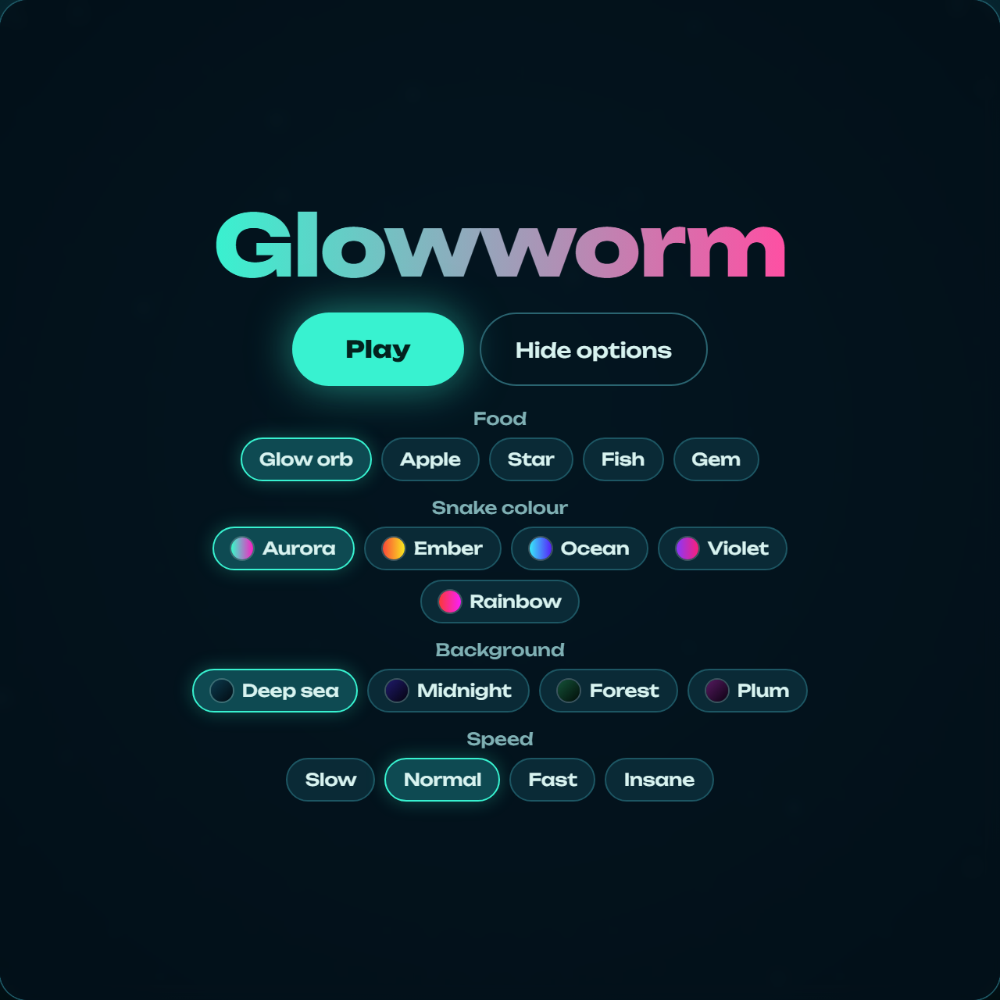
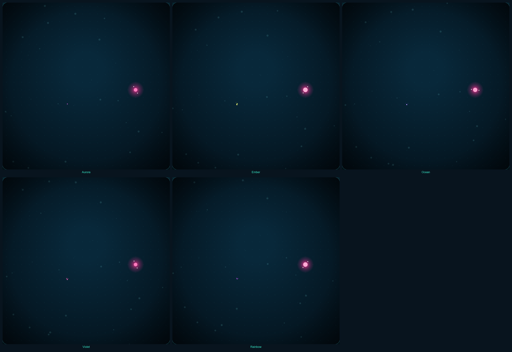
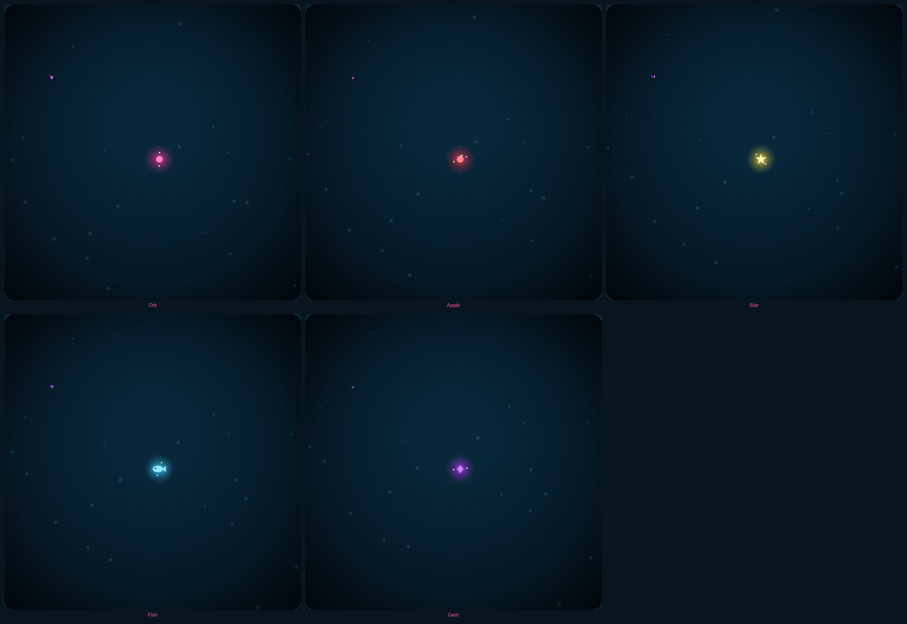
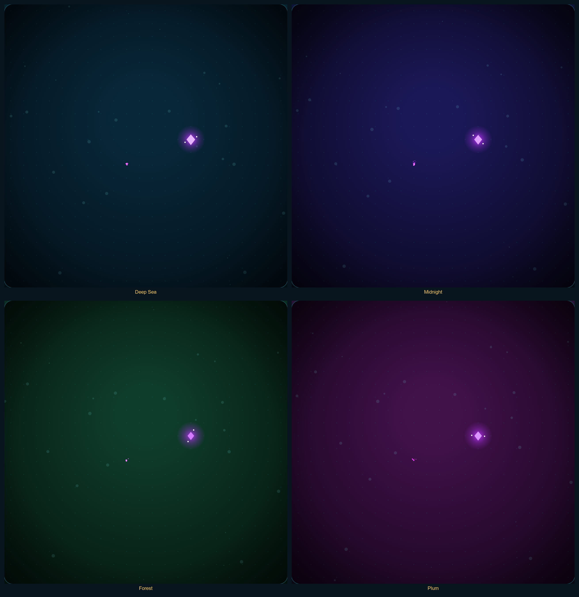

# 🐍 Glowworm

**A bioluminescent take on the classic Nokia Snake.**

---

## Gameplay

| Start screen | Combo and bonus orb | Options menu |
| --- | --- | --- |
|  |  |  |

| Snake colours | Food types | Backgrounds |
| --- | --- | --- |
|  |  |  |

## Features

- **Nokia-style wrap-around:** leave one edge and re-enter from the opposite side. Only the snake's own body ends the run.
- **Smooth motion:** the snake is interpolated between game ticks, so movement stays fluid at every speed.
- **Combo scoring:** eating quickly chains a multiplier, and each step in the chain raises the pitch of the eat sound.
- **Bonus orbs:** a timed golden orb appears every sixth food and grows the snake by three segments.
- **Progressive levels:** the game speeds up every five foods.
- **Particle effects:** bursts on eating, sparkles from the tail, floating score text and screen shake on death.
- **Synthesized sound effects:** eating, turning, bonus, level-up, start and game-over sounds, all generated live.
- **Customization:** choose the food (orb, apple, star, fish, gem), snake colour, background and speed.
- **Saved preferences:** your best score and chosen options persist between sessions.
- **Pause controls:** a pause button, keyboard shortcuts, and auto-pause when the tab loses focus.
- **Mobile support:** swipe controls and a responsive board that respects device safe areas.
- **Reduced motion:** screen shake is turned off when the system asks for reduced motion.

## Tech stack and what each part does

| Technology | Used for |
| --- | --- |
| **HTML5** | Page structure, the game canvas, the score bar (HUD), and the start, pause and game-over overlay. |
| **CSS3** | Layout, theming through custom properties, the glassy overlay, option chips, and safe-area spacing on phones. |
| **Vanilla JavaScript (ES6+)** | All game logic: movement, collisions, wrap-around, scoring, combos, levels, input handling and the options menu. |
| **Canvas 2D API** | Drawing the board, glowing snake, food shapes, particles, floating text and vignette. |
| **`requestAnimationFrame`** | The render loop, paired with a fixed-step timer so game speed stays consistent while drawing stays smooth. |
| **Web Audio API** | Generating every sound effect from oscillators, gain envelopes and filtered noise, with no audio files. |
| **Touch and keyboard events** | Swipe steering on mobile, plus arrow keys, WASD, pause and mute shortcuts. |
| **`localStorage`** | Saving the best score and the selected options in the browser. |
| **`matchMedia` (reduced motion)** | Detecting the reduced-motion setting so screen shake can be disabled. |
| **Page Visibility API** | Pausing automatically when the player switches tabs. |
| **Google Fonts (Unbounded)** | The display typeface, with system fonts as a fallback. |
